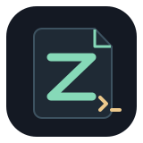
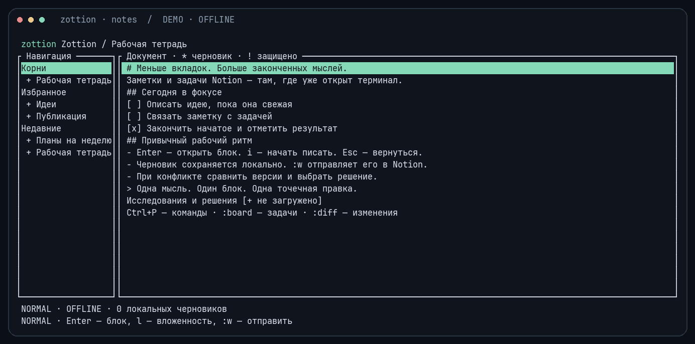
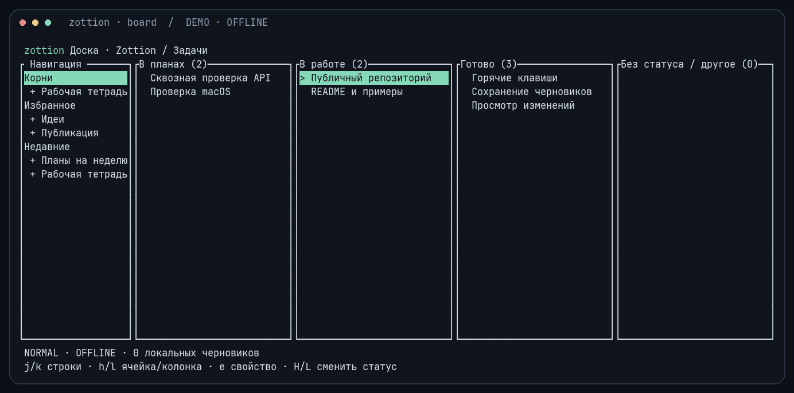
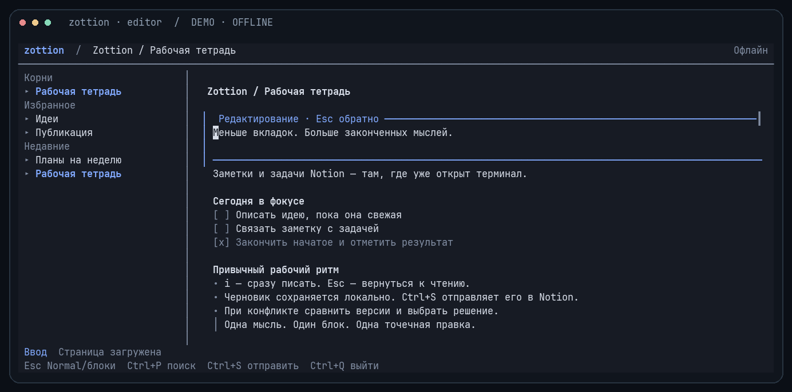
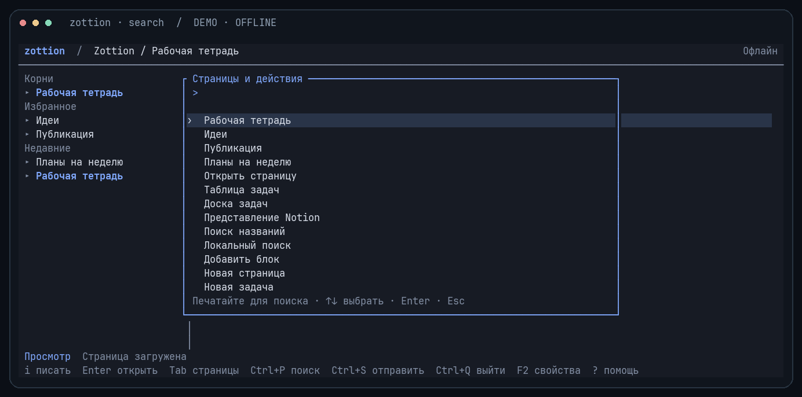

<div align="center">



# zottion

**English** · [Русский](README.ru.md)

### Notion. In your terminal.

Notes · tasks · Vim editing · a scriptable CLI

[](https://github.com/IgorKramar/zottion/actions/workflows/ci.yml)

[](LICENSE)


[Install](#install) · [Quick start](#quick-start) · [Keys](#keys) · [Safety](#drafts-and-writes) · [Docs](#documentation)

</div>



**Write a note, move a task, keep your draft — without leaving the terminal.**

zottion is an unofficial Rust TUI and CLI for Notion. It talks directly to the
official REST API, edits individual blocks by ID, and keeps drafts on your machine.
The application interface and messages are currently in Russian; the README is available in English and Russian.

<details>
<summary><strong>A board for the work behind your notes</strong></summary>



Use an existing data source, group cards by status/select, and update the underlying
page properties. Local panel and column settings do not modify shared Notion views.

</details>

<details>
<summary><strong>Edit in place and find your next page</strong></summary>





</details>

*Screens captured from the application with synthetic data, an offline cache, and
a custom terminal ANSI palette. No Notion connection was used.*

> **Early development.** The source is public; there is no stable release yet.
> Notes, tasks, conflicts and crash recovery have been tested against real Notion.
> OAuth, macOS Keychain and clean-system installation still need acceptance.
> See the [verification report](docs/verification.md) for results and limits.

## What's inside

| Area | Available |
|:---|:---|
| Notes | Pages, nested navigation, core block types, block-level EdTUI editing |
| Rich text | Links, mentions and formatting preservation; explicit range formatting |
| Tasks | Existing data source schemas, typed properties, tables and status/select boards |
| Views & search | Read existing views; search Notion titles or locally loaded content |
| Local state | Scoped SQLite cache, FTS5 search, durable drafts and an operation journal |
| Automation | Versioned JSON, stdin, cursors, profiles, exit codes and shell completion |
| Authentication | API token or browser OAuth through a self-hosted service; OS keychain storage |

Unknown blocks are displayed and protected. Files, comments, schema editing and
other view layouts are outside v0.1. See the [capability matrix](docs/capabilities.md).

## Install

Build from source with **Rust 1.91 or newer** and Git:

```sh
cargo install --git https://github.com/IgorKramar/zottion --locked zottion
zottion --help
```

Cargo usually installs to `~/.cargo/bin`; keep it in `PATH`. Linux and macOS are
the target platforms. There is no published binary release yet.

<details>
<summary>Build a local checkout</summary>

```sh
git clone https://github.com/IgorKramar/zottion.git
cd zottion
cargo install --path . --locked
```

</details>

Minimum terminal size: **80 × 24**. Unicode is supported; Nerd Fonts and truecolor
are optional. Set `NO_COLOR` to disable colors. Themes are `default`, `dark` and
`light`; the app starts with the dark theme. `:theme default` uses your terminal's
colors; `:theme light` switches the current session to light mode.

## Quick start

Choose one of three authentication paths. **An API token saved in the OS keychain
is the simplest option for your own workspace.** There is no hosted zottion OAuth
service yet; a Notion page or workspace URL cannot be used as `--server`.

### API token: save once

1. Open [Notion connections](https://app.notion.com/developers/connections), create
   a connection named `zottion`, and choose **API token**. Select your workspace
   and enable **Read content**, **Update content** and **Insert content**.
2. In **Content access → Edit access**, select the pages zottion should access
   and save. You can also use a page's **••• → Connections → Add connections**.
   Child pages inherit access. Copy the token from **Configuration**.
3. Run these commands in Bash and paste the token into the hidden prompt:

```bash
unset NOTION_TOKEN
read -rsp 'Notion API token: ' zottion_token
printf '\n'
printf '%s' "$zottion_token" | zottion auth login --token-stdin
unset zottion_token
zottion auth status --json
```

`verified: true` confirms a request to Notion succeeded. The token is saved in
Secret Service/Keychain and is available in new terminals. No OAuth service is
needed. `zottion auth logout` removes the local credential; rotate or revoke an
API token in Notion, then import a replacement with `--token-stdin`.
`auth refresh` and `auth logout --revoke` apply to OAuth credentials.

### Environment token: temporary or CI

```bash
read -rsp 'Notion API token: ' NOTION_TOKEN
printf '\n'
export NOTION_TOKEN
zottion auth status --json
```

This does not save the token. It lasts for the current shell and takes precedence
over keychain credentials. Use `unset NOTION_TOKEN` to return to the saved login.
Never put the token in a command argument, shell startup file or committed file.

### Browser OAuth: self-hosted

Browser login needs a configured zottion OAuth service and a registered Notion
OAuth connection. Set `ZOTTION_AUTH_SERVER` or pass `--server` with the
**root URL of that service**.

```sh
ZOTTION_AUTH_SERVER=https://YOUR_AUTH_HOST zottion auth login
zottion auth status --json
zottion open PAGE_ID_OR_NOTION_URL
```

After a successful OAuth login, the server is remembered: run `zottion auth login`
to sign in again. Browser login waits up to five minutes by default.
See [self-hosted OAuth](docs/oauth.md) for Render deployment without your own
domain, callback and token rotation. A public hosted server is not deployed yet. OAuth tokens are saved in the OS keychain too. Your connection must
have access to the pages you use.

After either login path:

```sh
zottion search Home --json
zottion open PAGE_ID_OR_NOTION_URL
```

Use a link copied from an actual page, not a workspace profile URL. If search is
empty or a page returns 404, check its connection access in Notion.

### Notes

On startup, zottion opens the most recent page, falling back to a pinned root.
Use **Ctrl+P** to filter known pages and actions, paste a Notion page link, or
choose “Search in Notion” for a title search. Enter opens the selected result.
Tab switches between the tree and document; tree section headings are skipped.

Select a block with `j/k` and press **i** to write directly in the document.
Surrounding blocks remain visible, and long text wraps and scrolls. Text changes
are saved locally. **Ctrl+S** (or `:w`) publishes loaded drafts on the current
screen; **Ctrl+Q** (or `:q`) exits while retaining unsubmitted drafts. Use `:diff`
to inspect versions before publishing. Mouse clicks open tree pages and select
blocks or cards; the wheel scrolls the pane under the pointer.

```text
:open PAGE_ID
:append to_do Prepare the next release
:new Research notes
:format bold true
:search project
:local architecture
```

### Tasks

```text
:table DATA_SOURCE_ID
:board DATA_SOURCE_ID Status
:task Check the CLI round trip
:view VIEW_ID
```

In a table, `h/l` selects a cell and `e` edits its property. On a board, `h/l`
selects a column, `j/k` selects a card, and `H/L` changes its status.
Press `b` to switch between table and board when a status/select property exists.
Structural commands such as `:append`, `:new` and `:task` execute the requested
operation immediately when online. Use `:refresh` to reload afterward.

### Scripts

```sh
zottion page get PAGE_ID --content --all --json
zottion block update BLOCK_ID --file - --json
zottion page create --data-source SOURCE_ID --title 'Review the API' --json
zottion page property set PAGE_ID --property Status --value-json '{"status":{"name":"Done"}}' --json
zottion data-source query SOURCE_ID --filter-file filter.json --all --json
zottion --offline draft list --json
zottion completions bash
```

Results go to stdout; diagnostics go to stderr. Lists expose a cursor; `--all`
follows pagination. `--json` produces schema version 1, including partial-result
metadata. Script commands never initiate browser login. [CLI contract](docs/cli.md).

## Keys

| Keys | Action |
|:---|:---|
| `j/k`, arrows | Select blocks, rows or cards |
| Enter | Open a page or edit a text block |
| `i` on a block; `v` in EdTUI | Write immediately / Visual mode |
| Esc, then Esc | Return to Normal mode, then block navigation |
| `h/l` | Collapse/load children; select table cells or board columns |
| Tab, `Ctrl+W` | Switch navigation/document focus |
| F2 | Toggle properties |
| `Ctrl+P`, `/` | Filter pages and actions; paste a page URL |
| PgUp/PgDn, `Ctrl+U/D` | Scroll a page / half a page |
| `Ctrl+S`, `Ctrl+Q` | Publish / exit with durable drafts |
| `Ctrl+R`, `?` | Refresh / help |
| `:w`, `:q`, `:wq` | Publish / exit with drafts / publish and exit |
| `:diff`, `:conflict` | Inspect changes and resolve a conflict explicitly |
| `:drafts`, `:apply ID` | Inspect drafts / explicitly submit one |
| `:operations`, `:check ID` | Inspect the journal / verify an operation |

## Drafts and writes

A draft is persisted before its request is sent. Before writing, zottion reads
the target again and compares the fields it will change. Conflicts keep the base,
local and remote versions. Notion's API does not provide a confirmed CAS mechanism,
so this check cannot eliminate every race with another client.

**An ambiguous write is never retried automatically.** Verify it with
`operation show` / `operation check`. For a create operation, check its parent
in Notion before explicitly recording whether it succeeded. `--yes` confirms an
action; it does not bypass conflict checks.

Offline mode reads loaded content and retains drafts. It does not send an
automatic queue when connectivity returns. Clearing the cache retains drafts and
the journal. Profiles, workspaces and credential identities isolate local state.
OAuth tokens are stored together in Secret Service/Keychain; an unavailable keychain
does not trigger a plaintext fallback. [Recovery details](README.ru.md#сохранность-и-восстановление).

## Documentation

[Русское руководство](README.ru.md) · [CLI](docs/cli.md) ·
[Capabilities](docs/capabilities.md) · [OAuth](docs/oauth.md) ·
[Architecture](ARCHITECTURE.md) · [Verification](docs/verification.md).

The detailed technical documents are currently in Russian.

## Development

```sh
cargo fmt --all --check
cargo clippy --workspace --all-targets --locked -- -D warnings
cargo test --workspace --locked
python3 scripts/check_terminal.py
cargo build --release --workspace --locked --target x86_64-unknown-linux-gnu
python3 scripts/package.py --target x86_64-unknown-linux-gnu
```

`rust-toolchain.toml` pins Rust 1.91.0. CI checks Linux and macOS. The manual
`packages` workflow builds Linux/macOS x86_64/ARM64 archives and checksums without
publishing a release or deploying the OAuth service.

Screenshots can be reproduced from a release build with `uv run
scripts/capture_screenshots.py --binary PATH_TO_ZOTTION --font PATH_TO_MONOSPACE_FONT`.
The capture tool uses temporary synthetic state and never contacts Notion.

[Contributing](CONTRIBUTING.md) · [Report a bug](https://github.com/IgorKramar/zottion/issues) · [Security](SECURITY.md).

## License

[MIT](LICENSE) · Copyright © 2026 [Igor Kramar](https://github.com/IgorKramar).
