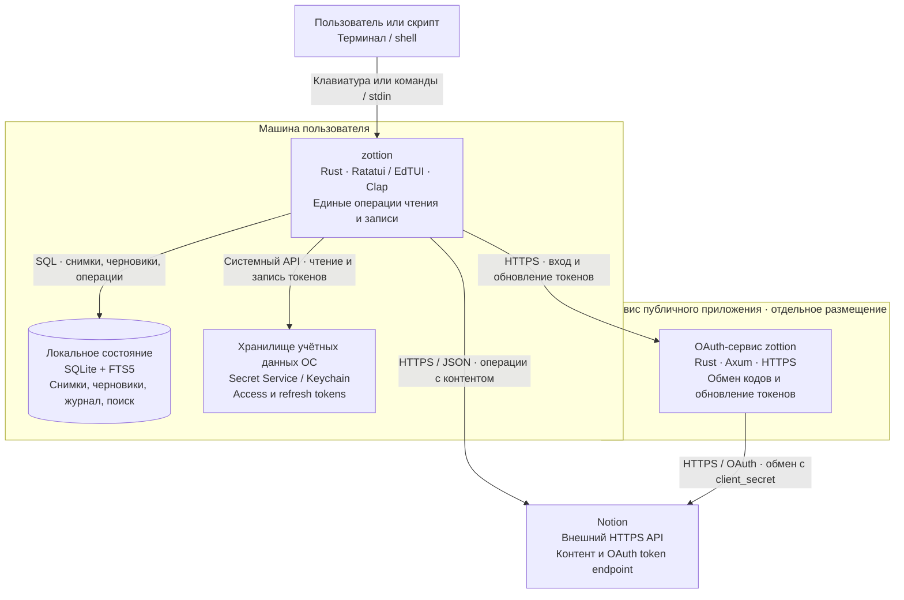

# C4 L2: дополнительный self-hosted OAuth с REST API

Статус: реализованные границы; интеграционная приёмка отдельно. Дата: 29 октября 2026 года.

Эта схема показывает дополнительный режим с собственной public connection.
Основной вход через локальный `ntn` описан в [ADR-0001](../decisions/0001-use-notion-cli-for-browser-login.md) и не требует такого размещения.

Уровень контейнеров показывает запускаемые части и хранилища. TUI и CLI — режимы одного приложения, не отдельные сервисы.

Сервис авторизации не проксирует страницы, но видит токены при обмене и является доверенным компонентом. Нужны защита одноразовой передачи результата, сроки сеансов, исключение секретов из журналов и отдельное ревью протокола. Размещение сервиса не выполнено.
